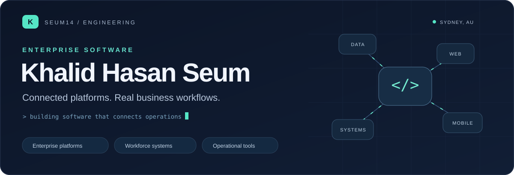
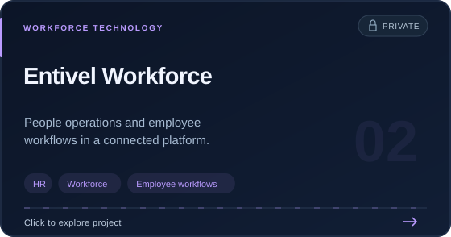
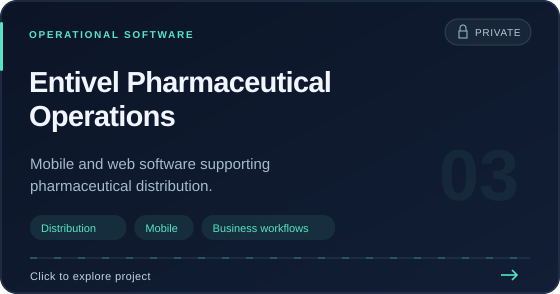
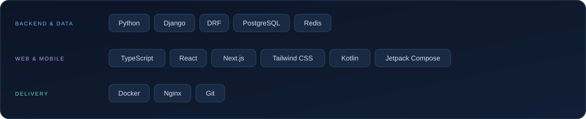

  

  
  
  

I focus on <strong>enterprise software</strong>: connected business platforms, workforce systems and operational tools. My recent work spans full-stack applications, web platforms and mobile experiences.

## Enterprise portfolio

Selected private projects developed under **Entivel**. Click a project card to expand its overview.

<table width="100%">
<tr>
<td width="50%" valign="top">

<h3>Entivel Workspace</h3>

A connected business workspace bringing core operational workflows into one platform.

<strong>Areas of work:</strong> Enterprise applications, business workflows, finance, customer operations and supply-chain processes.

<strong>Focus:</strong> Turning complex, connected business requirements into usable software experiences.

</td>
<td width="50%" valign="top">

<h3>Entivel Workforce</h3>

A workforce platform supporting people operations and employee workflows.

<strong>Areas of work:</strong> HR applications, employee lifecycle workflows and workforce operations.

<strong>Focus:</strong> Connecting everyday people processes through clear, consistent application experiences.

</td>
</tr>
<tr>
<td width="50%" valign="top">

<h3>Entivel Pharmaceutical Operations</h3>

Mobile and web software supporting pharmaceutical distribution and operational workflows.

<strong>Areas of work:</strong> Industry-specific business software, mobile experiences and operational data workflows.

<strong>Focus:</strong> Making practical business processes accessible through purpose-built applications.

</td>
<td width="50%" valign="top">

<h3>Entivel and Tivelin Web Platforms</h3>

Business websites and supporting web experiences across Entivel and Tivelin.

<strong>Areas of work:</strong> Web application development, responsive interfaces and digital presentation.

<strong>Focus:</strong> Translating business information into clear, usable online experiences.

</td>
</tr>
</table>

<strong>Additional private projects</strong>

My private development portfolio also includes **Entivel Social**, **Entivel Newsroom**, and earlier ERP and invoicing projects.

All featured enterprise repositories remain private. These summaries share project names and broad areas of work. Source code, internal architecture, business data and implementation details are confidential.

## Engineering toolkit

## Education

<strong>Public projects and academic portfolio</strong>

Earlier work documenting the foundations behind my software development, systems design and project-delivery skills:

| Project | Focus |
| --- | --- |
| [Restaurant Management System](https://github.com/seum14/Restaurant-Management-Project) | Java, MySQL and role-specific application workflows |
| [Multi-Campus University Network Design](https://github.com/seum14/Multi-Campus-University-Network-Design) | Network architecture, infrastructure planning and design documentation |
| [Modern Sketching Tools Web Prototype](https://github.com/seum14/Hi-fidelity-Prototype) | Responsive interfaces, interactive prototyping and usability testing |
| [Project Planning and Scheduling](https://github.com/seum14/Wedding-Project-Management) | Microsoft Project, dependencies, resource planning and critical path analysis |
| [Professional Communication Portfolio](https://github.com/seum14/ePortfolio) | Communication, teamwork and conflict resolution |

Enterprise software · Business systems · Practical engineering

