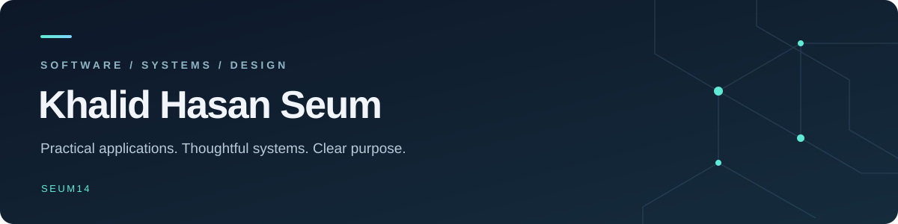

  

My focus is **enterprise software**: building connected business platforms and tools that turn complex operations into clear, usable workflows. My work spans full-stack applications, operational systems and mobile experiences.

**Sydney, Australia** · [LinkedIn](https://www.linkedin.com/in/seum14/) · [Explore my repositories](https://github.com/seum14?tab=repositories)

**Bachelor of Information Technology (Cyber Security)** · **CQUniversity, 2023** · **Graduated with Distinction**

## Enterprise software work at Entivel

My recent development work under **Entivel** spans private enterprise platforms and operational tools:

- **Business workspaces:** Applications that bring everyday business workflows into a connected experience.
- **Workforce systems:** Tools supporting people operations and employee workflows.
- **Pharmaceutical operations:** Mobile and web software supporting distribution workflows.
- **Digital experiences:** Websites and supporting web applications.

These projects are maintained in private repositories. This overview shares broad areas of work only; source code, internal architecture, business data and implementation details remain confidential.

## Earlier public projects

These academic and portfolio projects show the foundations behind my work in software, systems and project delivery.

| Project | Focus & deliverables |
| --- | --- |
| [Restaurant Management System](https://github.com/seum14/Restaurant-Management-Project) | Java and MySQL application with separate manager, staff and customer workflows, ordering, menu management and reviews. |
| [Multi-Campus Network Design](https://github.com/seum14/Multi-Campus-University-Network-Design) | University network design covering capacity planning, equipment selection, wired and wireless connectivity, diagrams and budget considerations. |
| [Modern Sketching Tools Web Prototype](https://github.com/seum14/Hi-fidelity-Prototype) | Responsive website prototype with product discovery, interactive navigation, dark mode and documented user acceptance testing. |
| [Project Planning & Scheduling](https://github.com/seum14/Wedding-Project-Management) | A 180-day Microsoft Project plan with a work breakdown structure, dependencies, resource allocation and critical path analysis. |

## Tools & foundations

- **Backend & data:** Python, Django, Django REST Framework, PostgreSQL and MySQL
- **Web & mobile:** TypeScript, React, Next.js, Tailwind CSS, Kotlin and Jetpack Compose
- **Additional foundations:** Java, Docker and Nginx
- **Systems & delivery:** Network design, requirements analysis, usability testing, technical documentation and project planning

## Connect

For technical conversations, collaboration or a discussion of my work, connect with me on [LinkedIn](https://www.linkedin.com/in/seum14/).
