

  <picture><source media="(max-width: 600px)" srcset="./hero-mobile-v4.svg" /></picture>

  
  
  
  

I focus on <strong>enterprise software</strong>: connected business platforms, workforce systems and operational tools. My recent work spans full-stack applications, web platforms and mobile experiences.

## Enterprise portfolio

Recent enterprise work under **Entivel**, alongside selected private business applications. Expand a project overview below each card.

<table width="100%">
<tr>
<td width="50%" valign="top">
<picture><source media="(max-width: 600px)" srcset="./project-workspace-mobile-v6.svg" />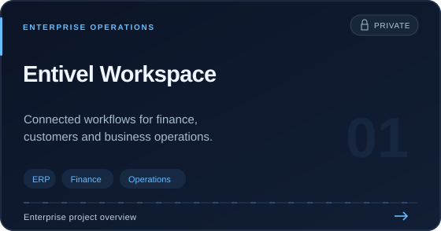</picture>

<strong>Explore Entivel Workspace</strong>

<h3>Entivel Workspace</h3>

A connected business workspace bringing core operational workflows into one platform.

<strong>Areas of work:</strong> Enterprise applications, business workflows, finance, customer operations and supply-chain processes.

<strong>Focus:</strong> Turning complex, connected business requirements into usable software experiences.

</td>
<td width="50%" valign="top">
<picture><source media="(max-width: 600px)" srcset="./project-workforce-mobile-v6.svg" />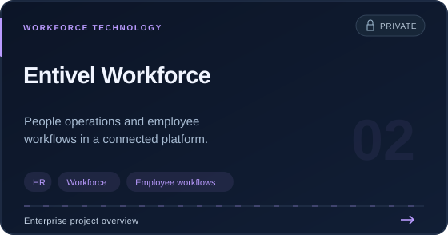</picture>

<strong>Explore Entivel Workforce</strong>

<h3>Entivel Workforce</h3>

A workforce platform supporting people operations and employee workflows.

<strong>Areas of work:</strong> HR applications, employee lifecycle workflows and workforce operations.

<strong>Focus:</strong> Connecting everyday people processes through clear, consistent application experiences.

</td>
</tr>
<tr>
<td width="50%" valign="top">
<picture><source media="(max-width: 600px)" srcset="./project-pharma-mobile-v6.svg" /></picture>

<strong>Explore Entivel Pharmaceutical Operations</strong>

<h3>Entivel Pharmaceutical Operations</h3>

Mobile and web software supporting pharmaceutical distribution and operational workflows.

<strong>Areas of work:</strong> Industry-specific business software, mobile experiences and operational data workflows.

<strong>Focus:</strong> Making practical business processes accessible through purpose-built applications.

</td>
<td width="50%" valign="top">
<picture><source media="(max-width: 600px)" srcset="./project-erp-mobile-v6.svg" />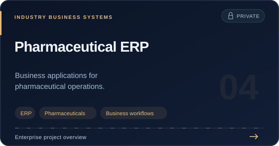</picture>

<strong>Explore Pharmaceutical ERP</strong>

<h3>Pharmaceutical ERP</h3>

A private enterprise resource planning project for pharmaceutical business operations.

<strong>Areas of work:</strong> Business application development and connected operational workflows.

<strong>Focus:</strong> Organising industry-specific processes through structured business software.

</td>
</tr>
<tr>
<td width="50%" valign="top">
<picture><source media="(max-width: 600px)" srcset="./project-invoicing-mobile-v6.svg" />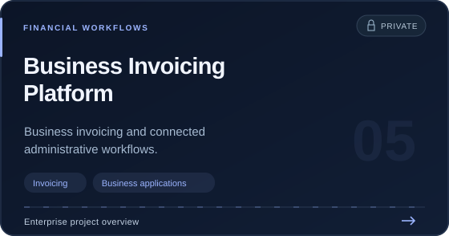</picture>

<strong>Explore Business Invoicing Platform</strong>

<h3>Business Invoicing Platform</h3>

A private business application focused on invoicing and related administrative workflows.

<strong>Areas of work:</strong> Invoice workflows, business data and application development.

<strong>Focus:</strong> Supporting practical financial administration through purpose-built software.

</td>
<td width="50%" valign="top">
<picture><source media="(max-width: 600px)" srcset="./project-social-mobile-v6.svg" />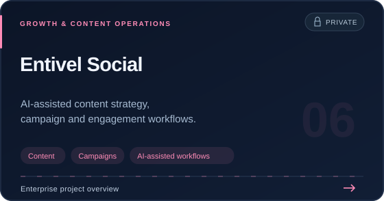</picture>

<strong>Explore Entivel Social Growth Platform</strong>

<h3>Entivel Social Growth Platform</h3>

A private platform supporting social content strategy, campaign planning and engagement workflows.

<strong>Areas of work:</strong> AI-assisted content operations, campaign workflows and engagement management.

<strong>Focus:</strong> Connecting content planning with practical business growth workflows.

</td>
</tr>
<tr>
<td width="50%" valign="top">
<picture><source media="(max-width: 600px)" srcset="./project-newsroom-mobile-v6.svg" />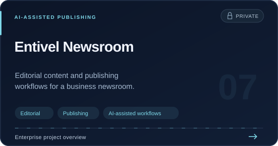</picture>

<strong>Explore Entivel Newsroom</strong>

<h3>Entivel Newsroom</h3>

A private business newsroom project supporting editorial content and publishing workflows.

<strong>Areas of work:</strong> AI-assisted content creation, editorial review and publishing operations.

<strong>Focus:</strong> Bringing content production and editorial control into a connected workflow.

</td>
<td width="50%" valign="top">
<picture><source media="(max-width: 600px)" srcset="./project-digital-mobile-v6.svg" />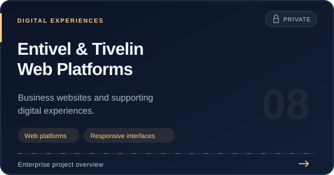</picture>

<strong>Explore Entivel and Tivelin Web Platforms</strong>

<h3>Entivel and Tivelin Web Platforms</h3>

Business websites and supporting web experiences across Entivel and Tivelin.

<strong>Areas of work:</strong> Web application development, responsive interfaces and digital presentation.

<strong>Focus:</strong> Translating business information into clear, usable online experiences.

</td>
</tr>
</table>

All featured enterprise repositories remain private. These summaries share project names and broad areas of work. Source code, internal architecture, business data and implementation details are confidential.

## Contributions and activity

Public and private work, shown through aggregate GitHub contribution counts.

<picture><source media="(max-width: 600px)" srcset="https://raw.githubusercontent.com/seum14/seum14/main/contributions-stats-mobile-20261119115048.svg" />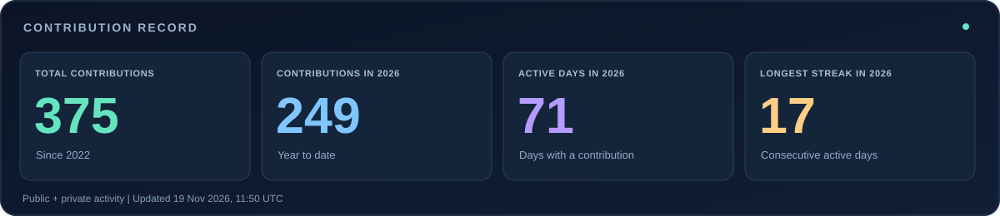</picture>

<a href="https://github.com/seum14?tab=overview#year-list-container"><picture><source media="(max-width: 600px)" srcset="https://raw.githubusercontent.com/seum14/seum14/main/contributions-heatmap-mobile-20261119115048.svg" />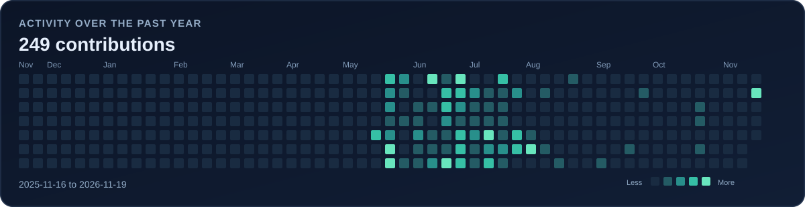</picture></a>

<picture><source media="(max-width: 600px)" srcset="https://raw.githubusercontent.com/seum14/seum14/main/contributions-history-mobile-20261119115048.svg" />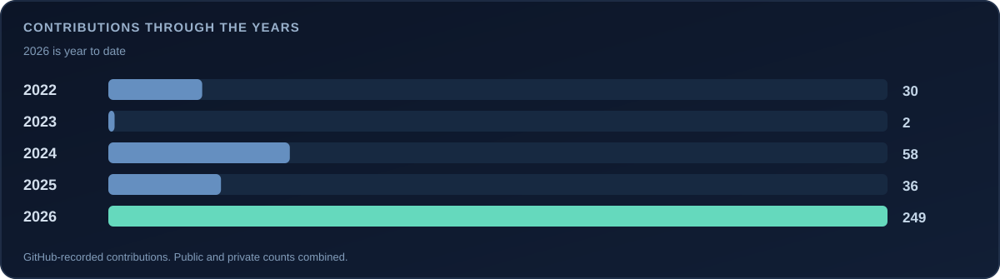</picture>

<strong>Explore contribution years on GitHub</strong>

<!-- CONTRIBUTION-YEARS:START -->

[2022](https://github.com/seum14?tab=overview&from=2022-01-01&to=2022-12-31) · [2023](https://github.com/seum14?tab=overview&from=2023-01-01&to=2023-12-31) · [2024](https://github.com/seum14?tab=overview&from=2024-01-01&to=2024-12-31) · [2025](https://github.com/seum14?tab=overview&from=2025-01-01&to=2025-12-31) · [2026](https://github.com/seum14?tab=overview&from=2026-01-01&to=2026-11-19)

<!-- CONTRIBUTION-YEARS:END -->

Refreshed daily from GitHub's contribution record. Private activity is anonymized; repository contents and access remain private.

## Engineering toolkit

<picture><source media="(max-width: 600px)" srcset="./toolkit-mobile-v4.svg" /></picture>

## Education

<picture><source media="(max-width: 600px)" srcset="./education-mobile-v4.svg" />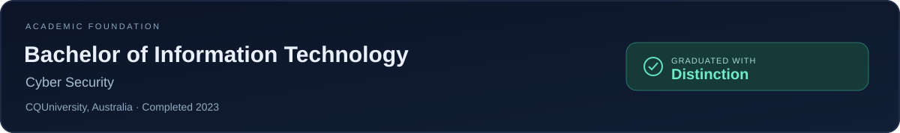</picture>

<strong>Public projects and academic portfolio</strong>

Earlier work documenting the foundations behind my software development, systems design and project-delivery skills:

| Project | Focus |
| --- | --- |
| [Restaurant Management System](https://github.com/seum14/Restaurant-Management-Project) | Java, MySQL and role-specific application workflows |
| [Multi-Campus University Network Design](https://github.com/seum14/Multi-Campus-University-Network-Design) | Network architecture, infrastructure planning and design documentation |
| [Modern Sketching Tools Web Prototype](https://github.com/seum14/Hi-fidelity-Prototype) | Responsive interfaces, interactive prototyping and usability testing |
| [Project Planning and Scheduling](https://github.com/seum14/Wedding-Project-Management) | Microsoft Project, dependencies, resource planning and critical path analysis |
| [Professional Communication Portfolio](https://github.com/seum14/ePortfolio) | Communication, teamwork and conflict resolution |

Enterprise software · Business systems · Practical engineering

